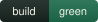
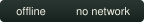
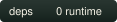
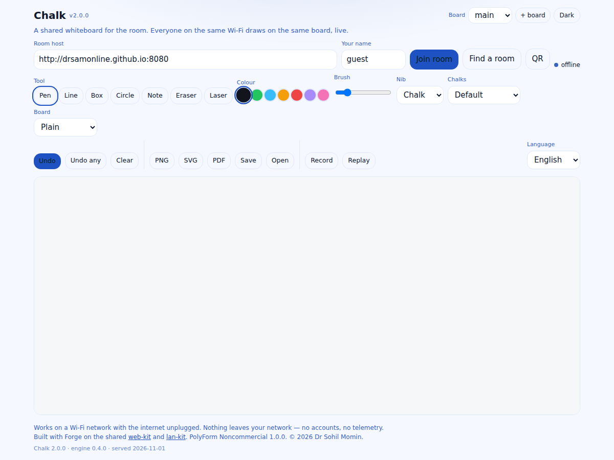

# Chalk

[](LICENSE)

<p>
  <a href="https://drsamonline.github.io/chalk-lan/"></a>
  
  
  <a href="LICENSE"></a>
  
  
</p>

**A shared whiteboard for the room.** Everyone on the same Wi-Fi draws on the same board, live.
No accounts, no internet, no telemetry — the strokes travel across your own network and nowhere else.

**[Open the board →](https://drsamonline.github.io/chalk-lan/play/)** ·
[Landing page](https://drsamonline.github.io/chalk-lan/) ·
[The rule](#what-it-must-not-do-and-does-not) ·
[Releases](#releases) ·
[What is in it](#what-is-in-it)

<!-- shot:start -->



<!-- shot:end -->

One person starts a room on a laptop in the room. The host prints a QR code and serves the board itself,
so anyone who scans it is on the shared board with the room already joined — and anyone who prefers to
type can enter the address or press **Find a room**. Draw with a finger, a mouse or a stylus; the strokes
cross your own network and stop there. A late joiner gets one snapshot of the board, not a replay.

## What it does

The app is **thin**: storage, languages, theming and accessibility come from **web-kit**; the room — SSE
for server→client, plain POST for client→server, a room code, a snapshot for late joiners — comes from
**lan-kit**. The only app-specific code is

- `docs/play/chalk.js` — the engine: the board document, the message protocol, the geometry a board needs
  (hit testing, shapes, SVG export) and the demo scenes the landing page draws. Pure, zero-dependency,
  and it runs unchanged in the browser and under Node, so the whole mechanic is tested headlessly;
- `docs/play/index.html` — the canvas, the toolbar, the join panel, the note editor, the QR panel;
- `docs/play/qr.js` — a zero-dependency QR encoder, so a room can be joined by pointing a phone at a
  terminal;
- `host/room.js` + `host/lan-host.js` — the room host, which also serves the board.

Every message is sanitised on arrival (colour, size, text and points are validated and clamped, strokes
bounded at 5000), so a buggy or hostile peer on the LAN cannot break the board.

| | |
|---|---|
| runtime dependencies | **0** |
| tests | **127 passing** — 115 engine, 12 host |
| message types on the wire | **7** — `point`, `stroke`, `note`, `undo`, `clear`, `cursor`, `snapshot` |
| languages | **6** — English, हिन्दी, ગુજરાતી, मराठी, বাংলা, தமிழ் |
| snapshot for a late joiner | **one message**, not 500 |

## What is in it

Everything that was on the list is built, and none of it costs a network call or a dependency.

**On the board**

- **Pressure and three nibs** — a point carries its pressure; chalk is soft and pressure-led, a marker is
  flat, a pen is thin and crisp.
- **Shapes that snap** — line, box and circle drag out as a preview and commit as one stroke; the corners
  overshoot the way a hand does.
- **Sticky notes** — a fifth message type carrying text items; notes move and edit by id.
- **Laser pointer** — a cursor that is drawn, fades, and is never stored in the document.
- **Four surfaces** — plain, dotted paper, a grid, a blackboard; all drawn on the canvas, no image fetched.
- **Three chalk sets** — default, Okabe–Ito colour-safe, and high contrast.
- **Undo anyone** — a mode where clicking a stroke or a note removes it, using a segment-aware hit test.

**Into the room**

- **Join by QR or room code** — the host serves the board, so its QR lands a phone in the room; the code
  sits beside the status dot.
- **Find a room** — `Lan.scan()` probes the device's own /24 for a Chalk host. No DNS, no internet.
- **Snapshot instead of replay** — one `snapshot` message, rebuilt through the engine on the host.
- **Draw through a dropped host** — messages that fail to send are queued and flushed in order on
  reconnect.
- **Named cursors** — every author's pointer, drawn with their name, fading on its own.
- **Several boards in one room** — every message carries a board id; the engine ignores other boards.

**Kept on the device**

- **Save and reopen** — `.chalk.json` out and in, through the tested codec.
- **SVG and PDF** — a vector export and print-to-PDF, both offline.
- **Autosave** — the board is written to IndexedDB and comes back after a reload.
- **Replay a session** — record the message log, then play it back with the gaps squeezed.

**Installed, and for everyone**

- **PWA** — a manifest and a service worker: HTML network-first, assets cache-first, cache name bumped per
  release, so a new build is never hidden behind the old one.
- **A single-file board** — `scripts/bundle.py` inlines everything into `docs/play/chalk-single.html`.
- **Keyboard drawing** — arrows move the point, space starts and ends a stroke.
- **Six languages.**

What is *not* there, and is not pretended otherwise: no mDNS/Bonjour (browsers cannot broadcast on the
LAN, so discovery is a subnet probe instead), no cloud, no iOS-native build, no voice or image import.

## What it must not do, and does not

- **No internet.** The app is four local scripts; the room is a socket on your own LAN. Unplug the WAN
  cable and the board keeps working.
- **No accounts.** A name for the author label, stored on the device, and nothing else.
- **No server of ours.** The host is a file you run yourself; there is no service to sign up to.
- **No telemetry.** There is no analytics call in this repository to disable.
- **No build step and no packages.** `npm install` is not part of running it.

## Releases

Every push to `main` builds the three downloads below from `docs/play`, publishes the rolling
`app-latest` release and deploys the page — all from the same commit, so the live demo and the released
build cannot disagree.

| | download | what it is |
|---|---|---|
|  **Android** | [chalk-lan.apk](https://github.com/drsamonline/chalk-lan/releases/download/app-latest/chalk-lan.apk) | signed WebView build |
|  **Windows** | [chalk-lan-portable.exe](https://github.com/drsamonline/chalk-lan/releases/download/app-latest/chalk-lan-portable.exe) | portable, no installer |
|  **Linux** | [chalk-lan-linux](https://github.com/drsamonline/chalk-lan/releases/download/app-latest/chalk-lan-linux) | single binary |

 **2.0.0** — 1 November 2026
Every enhancement on the list, built: pressure and nibs, snapping shapes, notes, a laser, four surfaces,
a colour-safe chalk set, undo-anyone, QR and room-code joining, a LAN scan, snapshots, a reconnect queue,
named cursors, several boards, save and reopen, SVG and PDF, autosave, session replay, a PWA, a
single-file build, keyboard drawing and six languages. The host now serves the board itself. Tests 50 → 127.

 **1.1.1** — 1 November 2026
The landing page stopped advertising the roadmap, and the colour swatches show their own colours again.

 **1.1.0** — 1 November 2026
A landing page of its own, the app moved to `docs/play/`, demo scenes drawn by the engine, a theme toggle
and a build stamp. Tests 38 → 50.

 **1.0.0** — 25 October 2026
PolyForm Noncommercial 1.0.0 everywhere, stated the same way in the licence, the headers and the README.

 **0.1.0** — 23 October 2026
First pass: the canvas board, the protocol with sanitisation, the zero-dependency room host, the build
workflow.

## Run it

**Start the room** (on one machine — a laptop, a Pi, anything with Node):

```bash
node host/room.js                 # room "chalk", port 8080
```

It prints the room code, the LAN address and a QR code. That address serves the board, so any device on
the same Wi-Fi can open it — or scan the code — and be in the room.

**Or open the board with no host at all:**

```bash
docs/play/index.html              # the app, from file://
docs/play/chalk-single.html       # the same board in one email-able file
```

```bash
node test-node.js      # the engine:  115 passed
node test-host.js      # the room:     12 passed
```

`?demo=lesson|erase|join` opens the board on a demo scene and `?theme=dark|light` pins the look for that
visit — both are how the screenshots and the landing page's frame are made.

## Layout

```
docs/index.html              the landing page
docs/play/index.html         the app — canvas, toolbar, join panel, note editor, QR panel
docs/play/chalk.js           the engine: document, protocol, geometry, scenes
docs/play/qr.js              the QR encoder
docs/play/web-kit.js         shared runtime: storage, i18n, theme, a11y, ui
docs/play/lan-kit.js         the LAN transport, the health probe and the subnet scan
docs/play/sw.js              the offline shell (network-first HTML, cache-first assets)
docs/play/manifest.webmanifest
docs/play/chalk-single.html  the whole board in one file, built by scripts/bundle.py
docs/assets/                 screenshots, generated badges and icons
host/room.js                 the room host you run
host/lan-host.js             SSE down, POST up, snapshots, static board
scripts/badges.py            draws docs/assets/badge-*.svg and checks each claim
scripts/icons.py             draws docs/assets/icons/*.svg
scripts/bundle.py            builds chalk-single.html
scripts/shot.sh              screenshots the landing page and the app
test-node.js                 the engine suite
test-host.js                 the host suite, over real HTTP
```

The badges, the icons and the QR code are all **generated, not fetched** — an offline-first board that
needs the network to describe itself would have broken its own rule.

## Support


Free, offline, accountless — and staying that way. If it earned its keep:

| | |
|---|---|
| UPI (India) | `drsohilboi@ybl` — payee Dr. Sohil Momin, open amount, or scan [the QR](docs/assets/upi-qr.svg) |
| GitHub Sponsors | [github.com/sponsors/drsamonline](https://github.com/sponsors/drsamonline) |
| Ko-fi | [ko-fi.com/matneo](https://ko-fi.com/matneo) |
| PayPal | [paypal.me/drsohilmomin](https://paypal.me/drsohilmomin?locale.x=en_GB&country.x=IN) |
| My books | [Amazon author store](https://www.amazon.com/stores/author/B08ZT331LY/allbooks?ccs_id=aed72b9f-71d9-41dc-adee-e9368a317acc) |
| More apps | [drsamonline.github.io](https://drsamonline.github.io/) |
| Email | [sohilmomin2000@gmail.com](mailto:sohilmomin2000@gmail.com) |

Nothing is gated behind it: no accounts, no tracking, no network requests.

## Licence

PolyForm Noncommercial License 1.0.0 — see [LICENSE](LICENSE). The required notice is the first line of
it. © 2026 Dr Sohil Momin. Part of the Forge system — apps open, orchestrator licensed.
